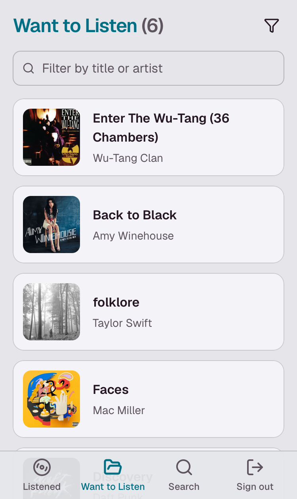
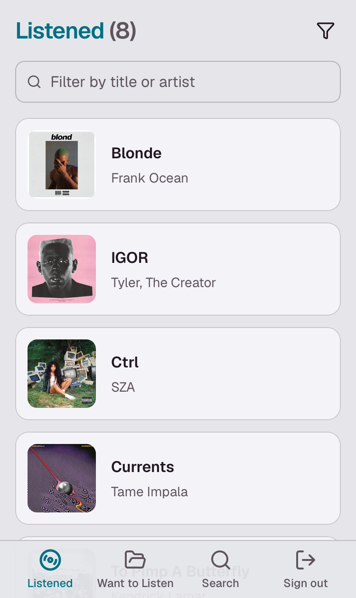
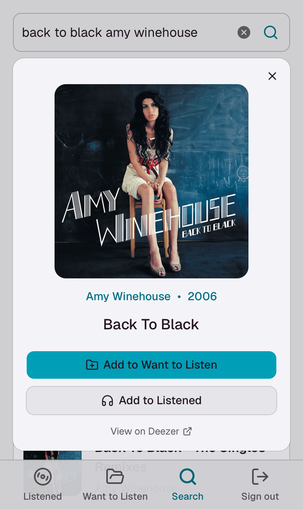
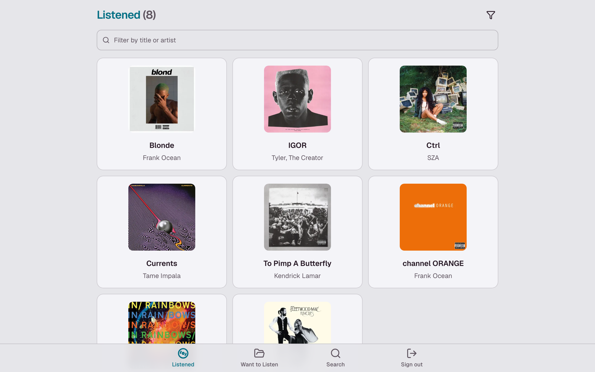

# Rotations

**The modern album listening tracker.** Keep a running list of albums you want to hear, mark them as listened once you have, and search a catalog of millions of albums to find your next one.

Rotations works on desktop and mobile, and you can install it on your phone's home screen like an app. All you need to sign in is a Google account. No streaming service required.

**[Try it at rotations-ten.vercel.app →](https://rotations-ten.vercel.app/)**

## Features

- **Want to Listen.** Search for an album and save it for later.
- **Listened.** Move an album over once you've heard it, or add it there straight from search.
- **Sort and filter.** Sort either list by date added, title, artist or release date, and filter by title or artist.
- **Installable.** It's a PWA, so you can add it to your phone's home screen and it opens full-screen like a native app.

| Want to Listen | Listened | Search |
|---|---|---|
|  |  |  |

On desktop, the lists switch to a grid:



## Tech stack

| | |
|---|---|
| Framework | [Next.js](https://nextjs.org) 16 (App Router), React 19, TypeScript (strict) |
| UI | [Tailwind CSS](https://tailwindcss.com) 4, [shadcn/ui](https://ui.shadcn.com) |
| Data and auth | [Supabase](https://supabase.com): Postgres, Google sign-in, Row Level Security |
| Album catalog | [Deezer API](https://developers.deezer.com/api), used for album metadata only |
| Validation | [Zod](https://zod.dev) at every external boundary |
| PWA | [Serwist](https://serwist.pages.dev) |
| Testing | Vitest + React Testing Library, Playwright, pgTAP |
| Hosting | [Vercel](https://vercel.com), deployed from GitHub Actions |

## Getting started

Requires Node.js 22.12 or newer, and Docker if you want to run the local Supabase stack.

```bash
npm install
cp .env.example .env.local   # fill in your Supabase project's URL and keys
npm run dev                  # http://localhost:3000
```

### Scripts

| Command | What it does |
|---|---|
| `npm run dev` | Start the dev server |
| `npm run build` | Production build |
| `npm run typecheck` / `lint` / `test` | Type-check, lint, and run unit tests |
| `npm run test:e2e` | Playwright tests that don't need sign-in |
| `npm run test:e2e:local` | Full Playwright suite against local Supabase (run `npx supabase start` first) |
| `npm run db:migrate` | Apply migrations to local Supabase |
| `npm run db:test` | Run the pgTAP Row Level Security tests |
| `npm run db:types` | Regenerate the TypeScript types for the database |

## Project structure

```
app/                  Pages and route handlers (App Router)
components/           UI components, built on shadcn/ui
lib/
  catalog/            Provider-neutral catalog entry point
  deezer/             Deezer API client
  schemas/            Shared Zod schemas
  supabase/           Supabase clients and typed queries
supabase/migrations/  SQL schema and RLS policies
tests/                Playwright e2e specs
legacy/               The original v1 app, kept for reference
```

## Deployment

Every push to `main` runs [`.github/workflows/deploy.yml`](./.github/workflows/deploy.yml). It type-checks, lints and runs the unit tests, then deploys to Vercel production if they all pass. The workflow needs the `VERCEL_TOKEN`, `VERCEL_ORG_ID` and `VERCEL_PROJECT_ID` repository secrets. The Supabase environment variables are stored in the Vercel project.

## Background

Rotations started as a vanilla HTML/CSS/JS app on Firebase that used the Spotify Search API. This version is a full rewrite on a modern stack. The original code is in [`legacy/`](./legacy), and [`design.md`](./design.md) explains the architecture and decisions, including why the catalog moved from Spotify to Deezer.

## Credits

Album data from [Deezer](https://www.deezer.com), used for non-commercial purposes under Deezer's API terms.
